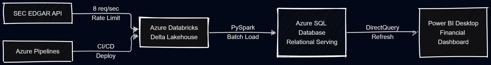
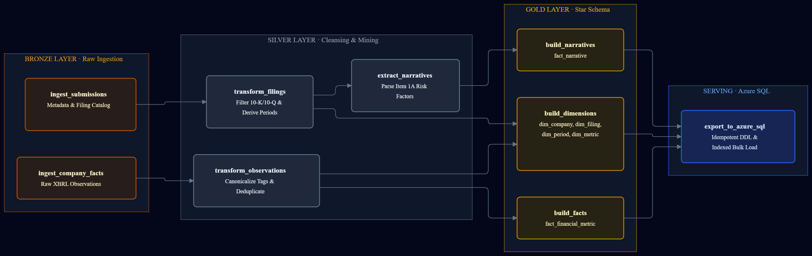
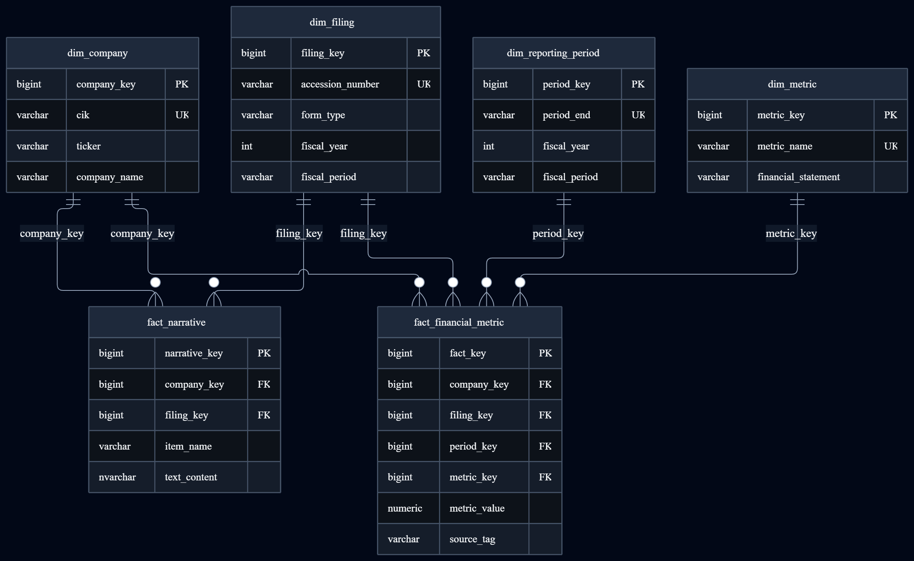
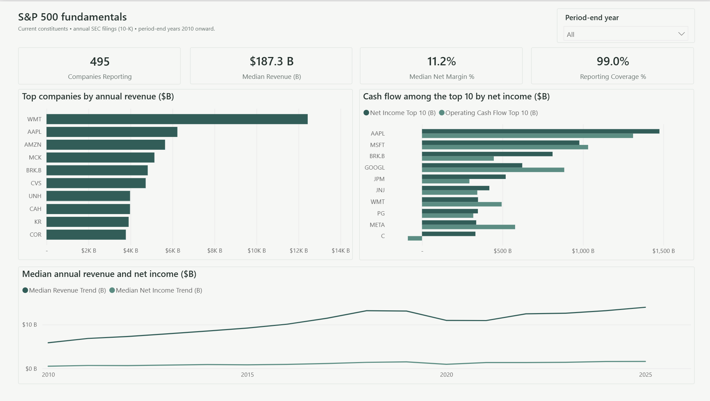
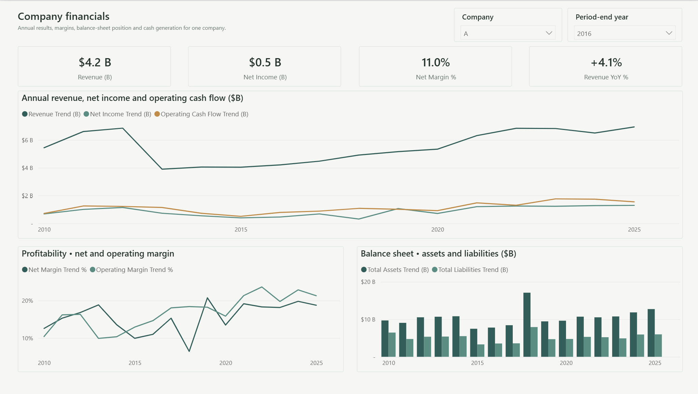
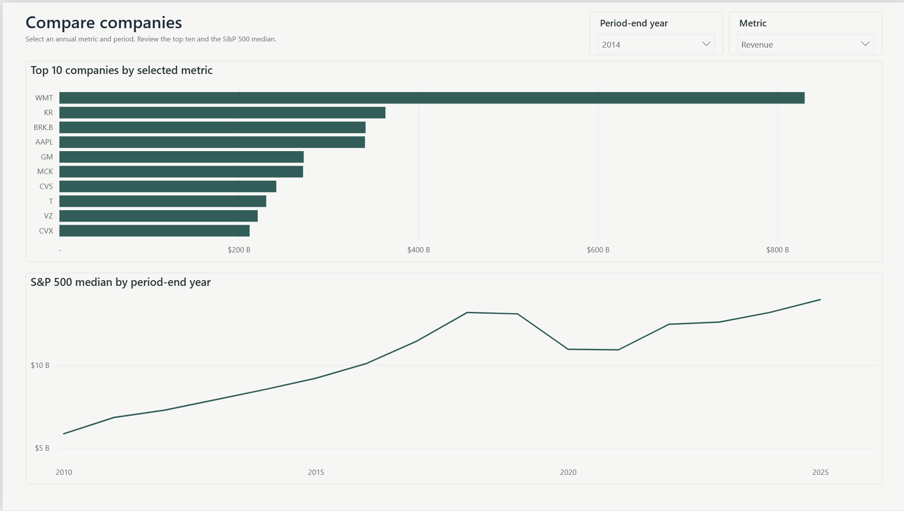
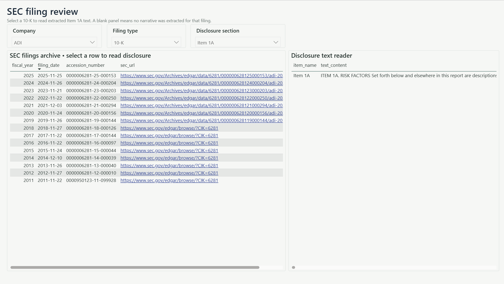
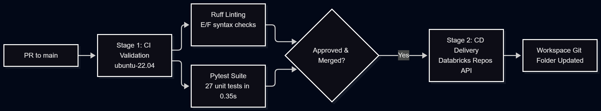

# SEC Financial Review Workbench: Product & Engineering Architecture

An end-to-end data platform that extracts, standardizes, and models 15+ years of SEC EDGAR filings for the S&P 500 into a Delta Lake Medallion architecture, loaded into an indexed Azure SQL star schema, and exposed through an interactive Power BI dashboard.

---

## 1. Business Context & Product Purpose

### Who Uses This?
* **Equity Research Analysts & Portfolio Managers**: Need to evaluate multi-year revenue growth, profitability margins, and cash generation across S&P 500 peers without manually compiling disparate SEC filings.
* **Credit & Risk Officers**: Need to track emerging business risks by reading management's filed **Item 1A (Risk Factors)** alongside actual balance sheet leverage and liquidity trends.

### The Problem in SEC EDGAR
SEC EDGAR is built for regulatory compliance, not financial analysis:
1. **Data Silos**: Financial numbers are stored in structured XBRL tables, while qualitative risk commentary is buried inside 50MB unstructured HTML documents. Analysts must manually copy numbers into spreadsheets while flipping across dozens of browser tabs.
2. **Accounting Taxonomy Divergence**: US-GAAP reporting varies across sectors. Commercial firms report sales (`SalesRevenueNet`), banks report net interest margins (`RevenuesNetOfInterestExpense`), and utilities report regulatory income (`RegulatedAndUnregulatedOperatingRevenue`). Standard screening tools leave banks and utilities blank.
3. **Survivorship Bias**: Traditional tools filter historical data using current index constituents, ignoring the 200+ companies that entered or left the S&P 500 since 2010 and skewing historical peer medians.

### The Solution & Business Impact
The **SEC Financial Review Workbench** automates the entire ingestion, standardization, and modeling lifecycle:
* **Research Turnaround**: Reduces multi-year peer benchmarking and qualitative risk reviews from **hours of manual spreadsheet copy-pasting to seconds**.
* **Universe Completeness**: Delivers **98.4% reporting coverage (492 of 500 companies)** by harmonizing banking, utility, and commercial reporting concepts.
* **Traceable Lineage**: Preserves **30,210 historical filings** and **399,482 financial facts** linked directly to official SEC source documents.

---

## 2. High-Level Architecture

* **Data Sourcing**: Ingests raw company submissions, XBRL company facts, and Form 10-K HTML reports from SEC EDGAR.
* **Lakehouse Processing**: PySpark on Delta Lake handles heavy JSON parsing, deduplication, taxonomy canonicalization, and regex narrative extraction.
* **Relational Serving**: Offloads the conformed star schema to Azure SQL with clustered and nonclustered B-tree indexes for sub-second query latency.
* **Analytical Presentation**: Serves an institutional Power BI report for macro index health, peer benchmarking, single-stock deep dives, and qualitative risk exploration.

---

## 3. Medallion ETL Pipeline Flow

The data pipeline runs on **Azure Databricks**, structured as a multi-task Medallion DAG:

### Engineering Mechanisms by Layer:

#### Bronze Ingestion
* **Throttling & Backoff**: Token-bucket rate limiter enforcing SEC EDGAR's **8 requests/second** ceiling, paired with exponential backoff and jitter on HTTP 429/503.
* **Idempotent Storage**: Payloads are compressed with `gzip` to minimize storage footprint on DBFS / Unity Catalog Volumes. `SHA-256` content hashing prevents re-downloading unchanged historical files.

#### Silver Harmonization
* **Cross-Sector Tag Canonicalization**: Maps disparate US-GAAP tags into 10 unified financial metrics:
  - *Commercial*: `RevenueFromContractWithCustomerExcludingAssessedTax`, `SalesRevenueNet`
  - *Financial Institutions (Goldman Sachs, Morgan Stanley)*: `RevenuesNetOfInterestExpense`
  - *Commercial Banks (Wells Fargo)*: `InterestAndDividendIncomeOperating`
  - *Regulated Utilities (DTE Energy, Xcel)*: `RegulatedAndUnregulatedOperatingRevenue`
* **Deduplication**: Resolves repeated comparative observations across restatements by prioritizing the latest filing date and full annual Form 10-K over 10-Q.
* **Narrative Extraction**: Regex boundary parser extracts Item 1A (Risk Factors) and Item 7 (MD&A) with a **1,000-character content-density threshold** to filter out Table of Contents hyperlinks while preserving genuine 86KB risk disclosures.

#### Gold Dimensional Mart
* **Point-in-Time Membership**: Outer-joins `configs/sp500.csv` to ensure all 500 constituents exist in `dim_company` without forward-looking survivorship bias.
* **Accession Backfilling**: Resolves 11,946 historical comparative accession keys referenced in facts, expanding `dim_filing` to **30,210 rows** with zero orphan foreign keys.
* **Surrogate Key Generation**: Stable 64-bit deterministic integer keys generated via hashing.

#### Serving Export
* Executes declarative idempotent DDL (`IF NOT EXISTS`) to provision tables and nonclustered B-tree indexes (`ix_company_ticker`, `ix_filing_cik`, `ix_period_fiscal_year`) in Azure SQL, guaranteeing **sub-250ms query latency** in Power BI.

---

## 4. Dimensional Data Model (Kimball Star Schema)

* **`dim_company`**: 500 constituents master dimension indexed on `ticker`.
* **`dim_filing`**: 30,210 filings catalog covering 10-K, 10-Q, and historical comparative accessions.
* **`dim_reporting_period`**: 6,666 accounting periods (duration vs. instant).
* **`dim_metric`**: 10 canonical metrics (Revenue, Net Income, Operating Cash Flow, Total Assets, etc.).
* **`fact_financial_metric`**: 399,482 narrow rows preserving raw source tags for auditability.
* **`fact_narrative`**: 991 extracted qualitative risk sections.

---

## 5. Power BI User Experience

The reporting layer connects directly to the Azure SQL serving layer, organized into four synchronized analytical pages (view high-resolution screenshots in [`images/`](images/)):

* **Page 1: S&P 500 Fundamentals (Macro & Universe Overview)**  
  Monitors index-level reporting coverage (492 of 500 companies reporting in 2025), long-term median net profit margin trends (12.8% in 2025), and cross-sector rankings of revenue leaders against operating cash flows to evaluate aggregate earnings quality.

  

* **Page 2: Peer Benchmarking & Comparison**  
  Enables cross-sectional equity screening across industry peers. Analysts dynamically rank and compare companies across any canonical metric (Revenue, Net Income, Operating Cash Flow, Total Assets, or Total Debt) and benchmark individual performance against 15-year index-wide medians.

  

* **Page 3: Company Financial Deep-Dive**  
  Provides historical analysis for individual tickers across 15 years of continuous filings. Visualizes longitudinal trajectories of revenue, net margin expansion or contraction, operating cash generation, and balance sheet leverage (Total Assets vs. Total Liabilities) across all reported 10-K and 10-Q statements.

  

* **Page 4: SEC Filing Review & Qualitative Risk Explorer**  
  Bridges quantitative metric modeling with regulatory disclosures. Analysts select any historical filing to inspect submission metadata, access direct hyperlinks to the official SEC EDGAR archive, and review parsed **Item 1A (Risk Factors)** narratives side-by-side with underlying fundamentals.

  

---

## 6. CI/CD & DataOps

* **In-Memory Testing**: Core transformation and parsing logic is tested against synthetic JSON payloads in under 45 seconds on Linux runners, eliminating 5-8 minute cluster cold-starts during PR reviews.
* **Decoupled Delivery**: Merges to `main` update the Databricks Git folder. Data execution (ETL) is managed independently by Databricks Workflows, ensuring code releases never trigger accidental 500-company data backfills.
